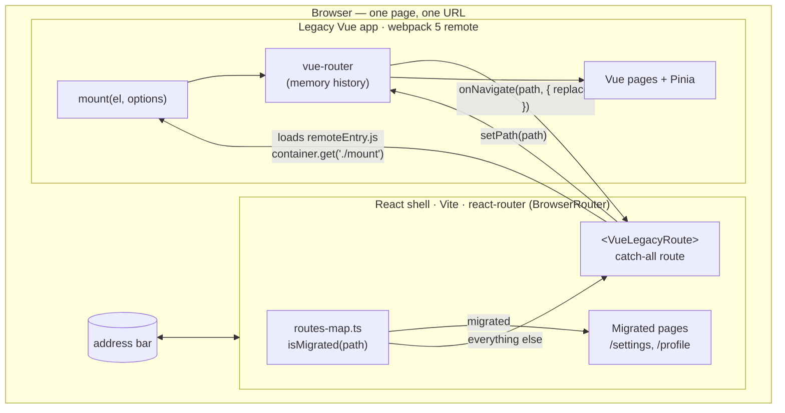

# vue-react-strangler

Migrate a Vue 3 app to React **one page at a time**, in production, without a feature freeze.

A React shell owns the URL and renders every page that has been migrated. Everything else is
rendered by the untouched legacy Vue app, loaded at runtime as a webpack Module Federation remote
and driven through a three-method contract. Migrating a page is one line in a routes map; rolling
it back is deleting that line.

This repo is a small, working reference implementation of the setup, plus the
[list of traps](docs/PITFALLS.md) we hit doing it on a real product.

## Why not a rewrite?

A big-bang rewrite freezes features for months and ships every bug at once. The
[strangler fig pattern](https://martinfowler.com/bliki/StranglerFigApplication.html) grows the
new system around the old one until the old one can be deleted:

- Users never see a "new version" launch: pages change one by one.
- Feature work continues in Vue until a page's turn comes.
- Every migrated page can be rolled back instantly.
- The legacy app keeps working standalone, so it can still be developed and tested on its own.

## Architecture



**Who owns what**

| Concern | Owner |
| --- | --- |
| The address bar and `window.history` | Shell only (`BrowserRouter`) |
| Which page renders a path | `routes-map.ts` |
| Legacy route resolution, guards, redirects | Legacy `vue-router` on **memory** history |
| Global CSS | Shell; legacy CSS is confined to a low-priority cascade layer |

## The mount contract

The two apps share exactly one thing: [`packages/contract/index.d.ts`](packages/contract/index.d.ts).

```ts
type MountFn = (element: HTMLElement, options?: {
  initialPath?: string;                                         // shell URL at mount time
  onNavigate?: (path: string, o: { replace: boolean }) => void; // legacy → shell
}) => Promise<{
  setPath(path: string): Promise<void>;                         // shell → legacy, no-op if already there
  unmount(): void;
}>;
```

How the URL stays in sync without loops:

1. **Shell → legacy.** When the shell's location changes on a legacy path, it calls
   `setPath(pathname + search + hash)`. The legacy side ignores a path it is already on.
2. **Legacy → shell.** After every legacy navigation, `onNavigate(fullPath, { replace })` fires.
   The shell ignores a path it is already on (that is the echo of step 1). `replace` is true for
   redirects, so the back button never bounces through a redirecting URL.
3. **Boot.** The legacy router resolves `initialPath` *before* the `afterEach` listener exists,
   then reports the landing path once, as a replace. Boot redirects never become history entries.

Both rules are pure functions in [`url-sync.ts`](apps/shell-react/src/migration/url-sync.ts) and
are unit-tested; the legacy side of the contract is tested against the real Vue app in
[`mount.spec.js`](apps/legacy-vue/tests/mount.spec.js).

## Run it

Requires Node 20+ and pnpm (`corepack enable`).

```bash
pnpm install
pnpm dev        # shell on http://localhost:3000, legacy remote on http://localhost:8080
```

Open <http://localhost:3000>. The nav mixes React and Vue pages (each link is tagged). Things to try:

- `/` → the legacy router redirects to `/legacy/dashboard`; press Back and you leave the app
  instead of bouncing (boot redirect = replace).
- **Reports archive** is an old URL that redirects inside Vue; the shell URL follows.
- From the Vue dashboard, click **Settings**: the legacy router hands the URL to the shell, React
  renders the page and the Vue app is unmounted.
- Back/forward across the boundary in both directions.
- <http://localhost:8080> runs the legacy app standalone, through the same `mount()` contract.

Production build, served from one static host:

```bash
pnpm build      # builds both apps, copies the remote to apps/shell-react/dist/remotes/legacy-vue/
pnpm preview    # http://localhost:4173
```

Quality gates (all run in CI):

```bash
pnpm lint && pnpm typecheck && pnpm test
pnpm build && pnpm test:e2e   # Playwright against the production build
# E2E_BASE_URL=http://localhost:3000 pnpm test:e2e   # same suite against a running `pnpm dev`
```

## Migrating a page, step by step

Say `/legacy/reports` is next.

1. **Build the React page** in `apps/shell-react/src/pages/ReportsPage.tsx`. Keep the URL and
   its query parameters identical, since users have bookmarks.
2. **Register it.** Add `"/legacy/reports"` to `MIGRATED_ROUTES` in
   [`routes-map.ts`](apps/shell-react/src/migration/routes-map.ts) and the component to
   `MIGRATED_PAGES` in [`pages/index.ts`](apps/shell-react/src/pages/index.ts). The `Record` type
   makes a missing component a compile error.
3. **Leave the Vue page alone** for a release. Links inside Vue that point to it now go through the
   legacy catch-all, report the path to the shell, and React takes over.
4. **Roll back if needed** by deleting the line from `MIGRATED_ROUTES`. Nothing else changes.
5. **Delete the Vue page** once the React version has been stable for a while.
6. When `MIGRATED_ROUTES` covers everything, delete `VueLegacyRoute`, the remote, and this README.

## Project layout

```
apps/
  legacy-vue/            Vue 3 + vue-router + Pinia, webpack 5 + ModuleFederationPlugin
    src/federation/mount.js     the exposed module: the contract implementation
    src/standalone.js           the same app run on its own, via the same contract
    tests/mount.spec.js         contract tests against the real app (Vitest + jsdom)
  shell-react/           React 19 + Vite + react-router 7
    src/migration/routes-map.ts the migration switch
    src/migration/url-sync.ts   pure URL-sync rules
    src/lib/remote-loader.ts    generic, memoized webpack-remote loader
    src/components/VueLegacyRoute.tsx
packages/contract/       the mount contract (types only)
scripts/assemble.mjs     puts the remote under the shell's dist
docs/PITFALLS.md         what broke, why, and the fix
e2e/                     Playwright: redirects, history, mount lifetime, CSS layering
```

## Read next

[**docs/PITFALLS.md**](docs/PITFALLS.md): the six problems that cost the most time, each with the
root cause and the fix that is in this repo.

## License

[MIT](LICENSE) © Maor Barel
